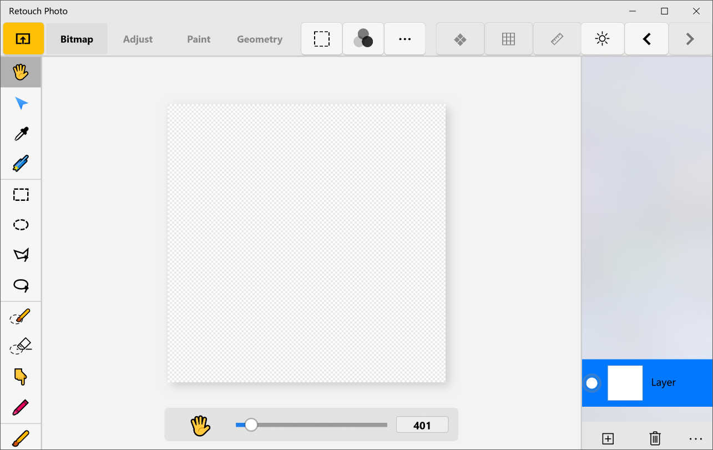
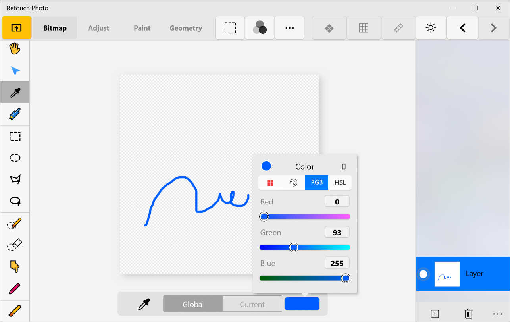
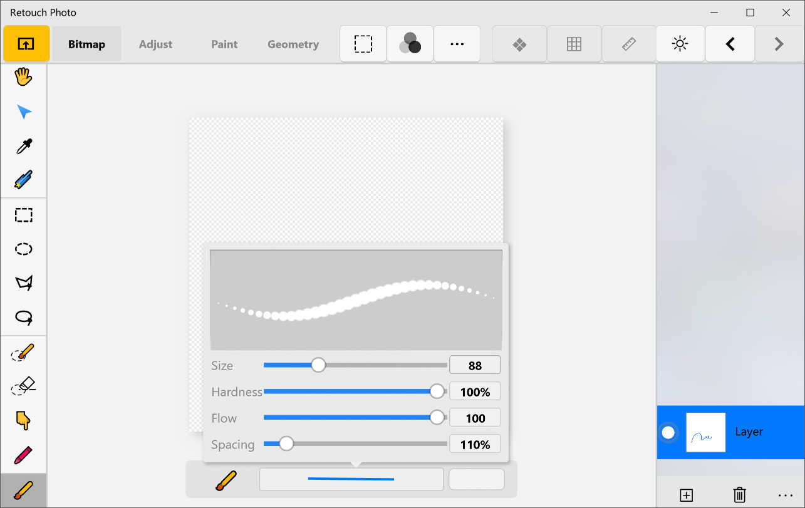
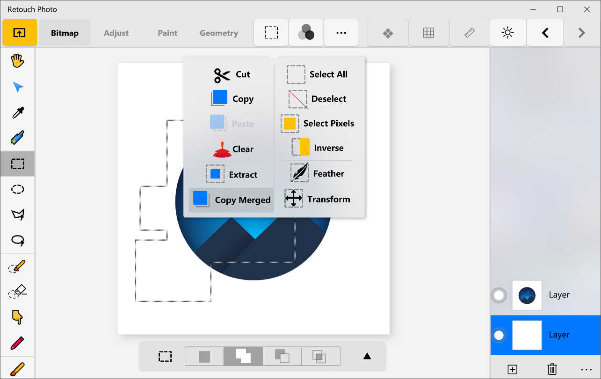
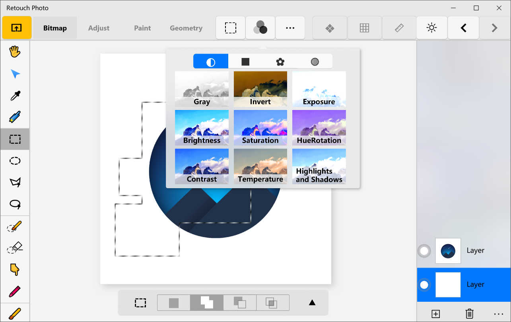
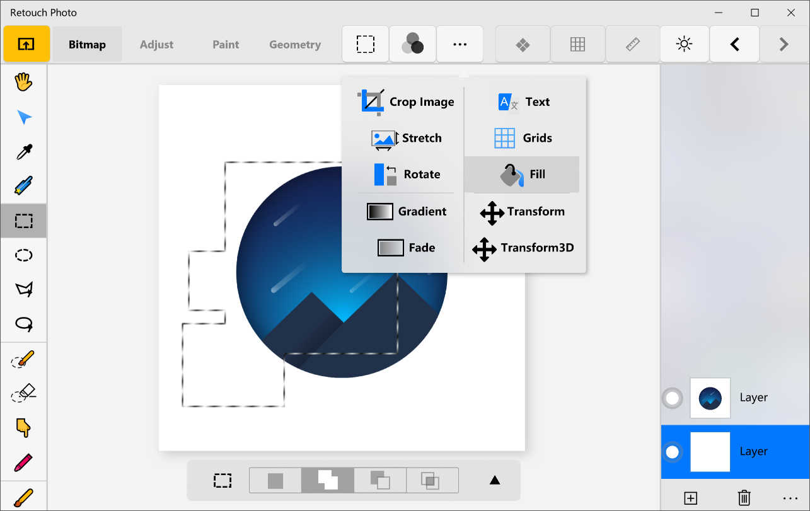
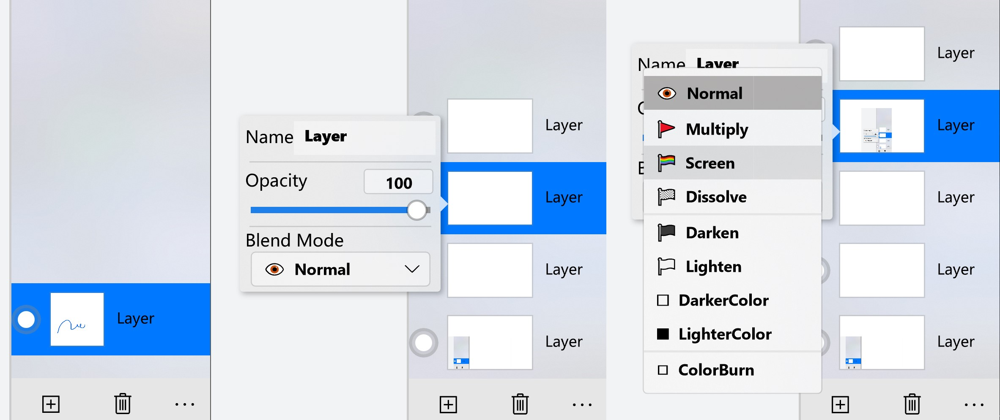
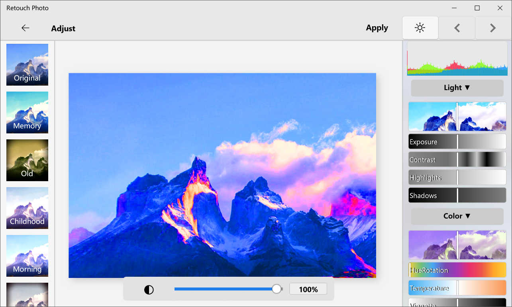
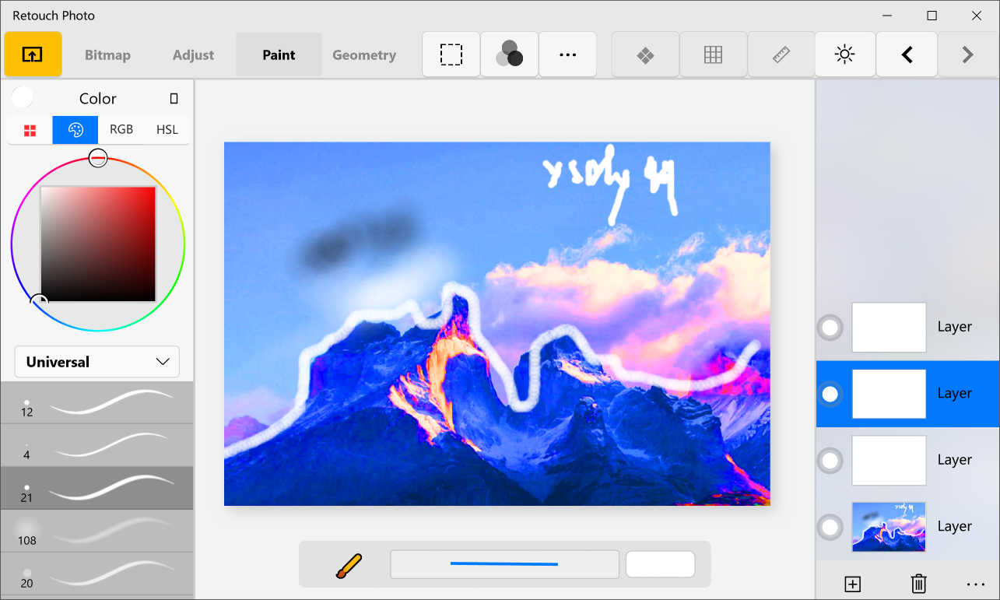
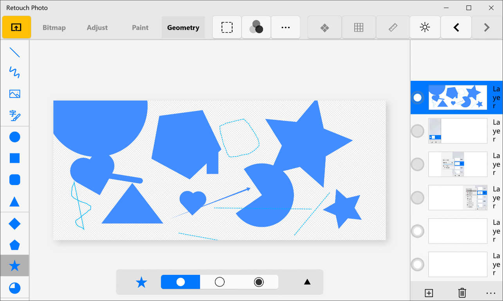

# Retouch-Photo-UWP
Simple and free photo retouching tools,can transform,adjustment, shear,filling images,support layer,the selecti on. If you think that the PS is too complex might as well try.
[form windows10 app-store](https://www.microsoft.com/store/productId/9N2SVF2769GH)   

  

（Maintenance has been stopped）

## 1.new project
new project> width:1000 height:1000>OK
  

## 2.Tools
Rrtouch-Photo provide dozens of tools: hand,curves,straw,Magic Wand,,Rectangular Marquee,Elliptical Marquee,Polygonal Marquee,Free Hand,,Selection Paint,Selection Eraser,Smudge,Mixer,,paint,pencil,pen,eraser......  
[ToolControl](%E4%BF%AE%E5%9B%BE/Control/ToolControl.xaml)     
[ToolPage](https://github.com/ysdy44/Retouch-Photo-UWP/tree/master/%E4%BF%AE%E5%9B%BE/BarPage/ToolPage)  
  

## 3.Canvas
When you choose a different Tool, barPage will navigate to the corresponding Page。  
At this point, you can perform operations on the MainCanvasControl  
[MainCanvasControl](%E4%BF%AE%E5%9B%BE/Control/MainCanvasControl.xaml)
  
  

## 4.Edit
Edit Lasso selected mask by :Cut,Copy,Paste,Clear,Extract,Copy Merged  
Edit Lasso by :Select All,Deselect,Select Pixel,Inverse,Feather,Transform   
[MaskButton](%E4%BF%AE%E5%9B%BE/Control/MaskButton.xaml)
  

## 5.Effect
Add special effects to the image with parameters  
[Effect](https://github.com/ysdy44/Retouch-Photo-UWP/tree/master/%E4%BF%AE%E5%9B%BE/BarPage/EffectPage) 
Gray,Invert,Exposure,Brightness,Saturation,HueRotatom,Contrast.Temperature,Highights and Shadow  
[Effect1](https://github.com/ysdy44/Retouch-Photo-UWP/tree/master/%E4%BF%AE%E5%9B%BE/BarPage/EffectPage1) 
DirectionBlur,GaussianBlur.Sharp.en.Shadow.Chromakey.EdgeDetection,Border,Emboss,Lighting  
[Effect2](https://github.com/ysdy44/Retouch-Photo-UWP/tree/master/%E4%BF%AE%E5%9B%BE/BarPage/EffectPage2) 
LuminanceToAlpha,Fog,Sepia,Posterize,Colouring,Tint,DiscreteTransfer,Vignette,GammaTransfer  
[Effect3](https://github.com/ysdy44/Retouch-Photo-UWP/tree/master/%E4%BF%AE%E5%9B%BE/BarPage/EffectPage3) 
Glass,Pinch and Punch,Morphology  
[EffectBuuton](%E4%BF%AE%E5%9B%BE/Control/EffectBuuton.xaml)
  

## 6.Others
Other operations:Crop,Stretch,Rotate,Gradient,Fade
Text,Grid,Fill,Transform  
[OtherButton](%E4%BF%AE%E5%9B%BE/Control/OtherButton.xaml)
  

## 7.Layer
Add,Delete,Merge,Duplicate Layers  
Change the Name of the layer, Opacity, BlendMode  
Normal,Multiply,Screen,Dissolve,,Darken,Lighten,DarkerColor,LighterColor,,ColorBurn,ColorDodge,LinearBurn,LinearDodge,,Overlay ,HardLight,VividLight,LinearLight,PinLight,,HardMix,Difference,Exclusion,,Hue,Saturation,Color,,Luminosity,Subtract,Division  
[LayerControl](%E4%BF%AE%E5%9B%BE/Control/LayerControl.xaml)
  

## 8。Adjustment Mode
Use the parameter slider on the right to change the effect of the picture  
[AdjustControl](%E4%BF%AE%E5%9B%BE/Control/AdjustControl.xaml) 
You can also choose ready-made filters  
[FilterControl](%E4%BF%AE%E5%9B%BE/Control/FilterControl.xaml)
  

## 9.Paint Mode
It is now a professional drawing software 
[ColorPicker](%E4%BF%AE%E5%9B%BE/Picker/ColorPicker.xaml) 
[BrushControl](%E4%BF%AE%E5%9B%BE/Control/BrushControl.xaml)

## 10.Geometry
You can freely draw any shape 
[GeometryControl](%E4%BF%AE%E5%9B%BE/Control/GeometryControl.xaml)

